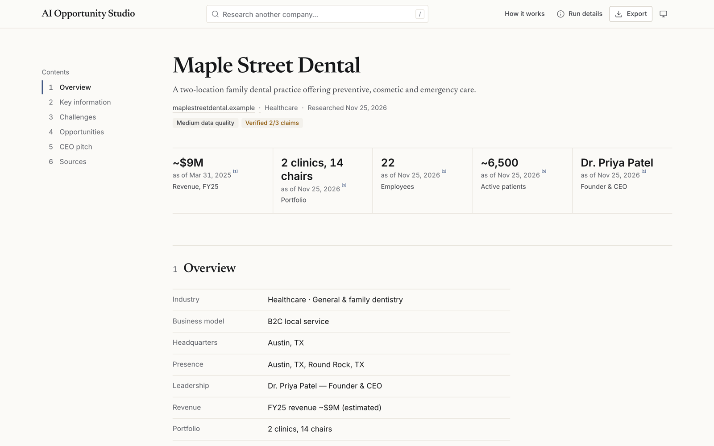
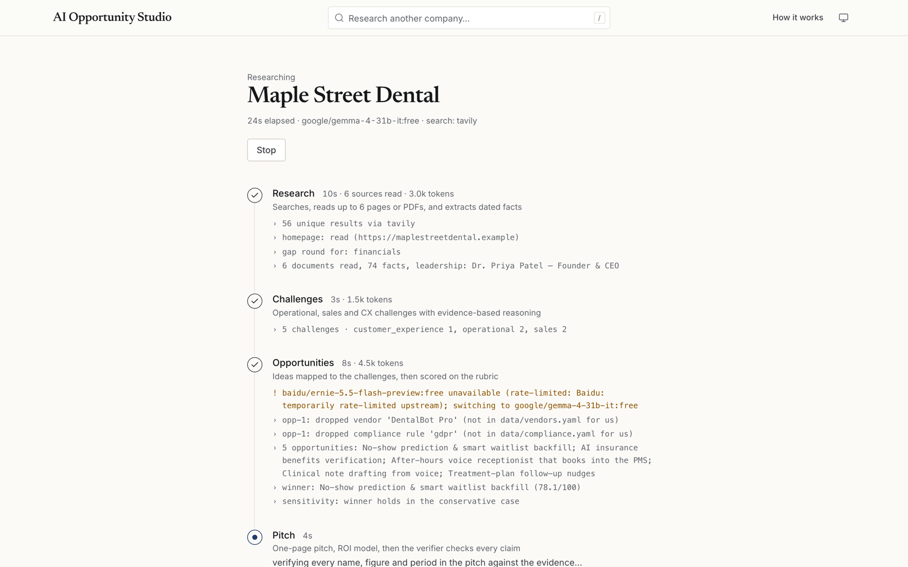
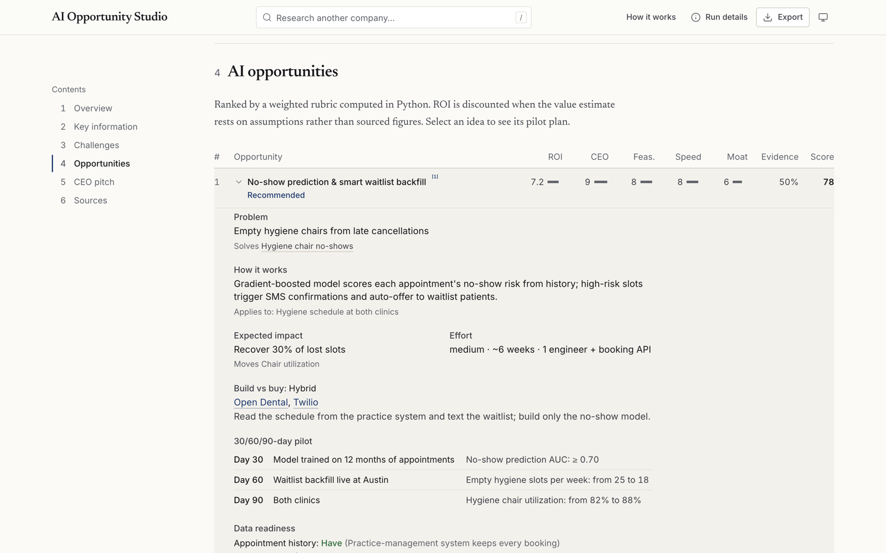
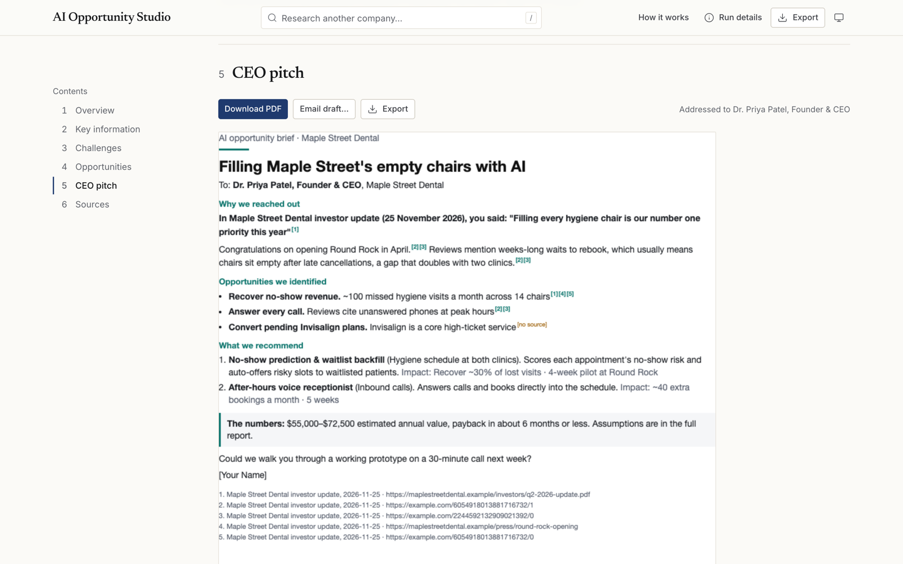
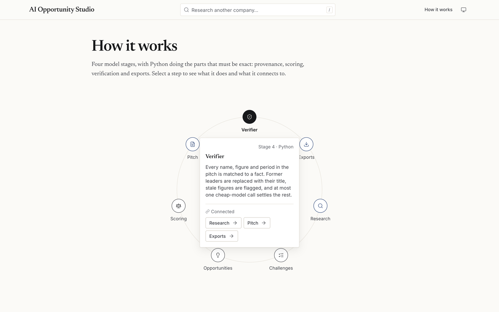
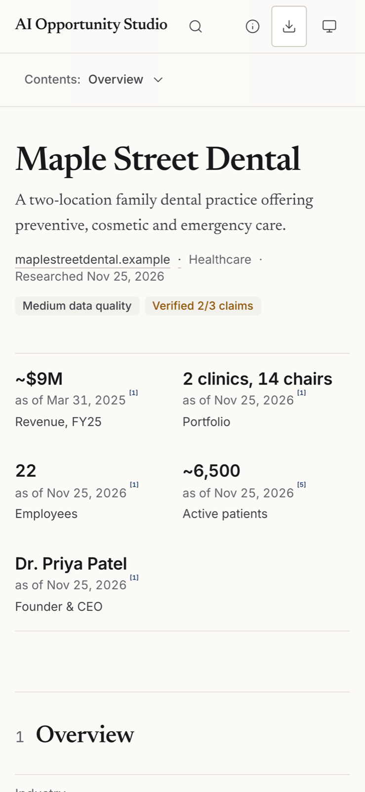
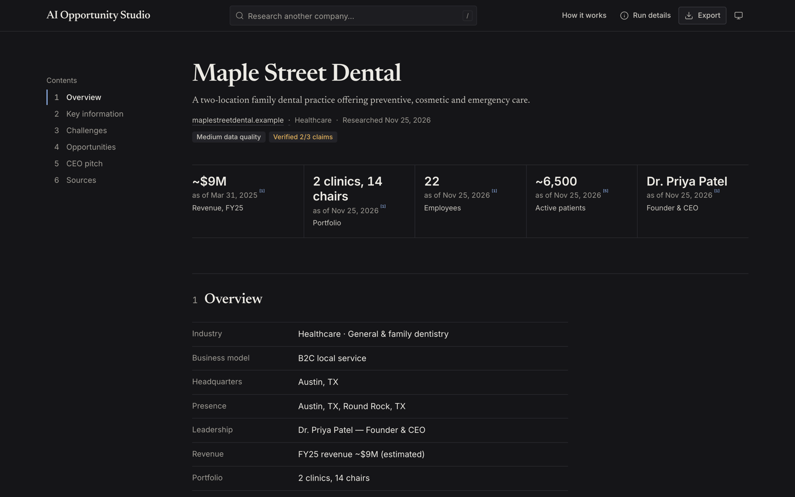

# AI Opportunity Pipeline

Give it a company name. It reads the company's own filings, investor updates and recent news. Then it diagnoses the business's challenges with explicit reasoning, ranks company-specific AI opportunities, and writes a one-page pitch to the CEO. Every claim carries a numbered, dated citation, and every name and figure in the pitch is checked against the evidence before it's written.



Each run produces a **5-section assessment**:
1. Company overview
2. Key business information
3. Business challenges with reasoning
4. AI opportunities
5. A one-page personalized CEO pitch

You can also download a full-report PDF, a one-page pitch PDF, a 10-slide deck and an email draft.

**Docs:**
- [docs/APPROACH.md](docs/APPROACH.md): architecture, decisions and trade-offs, the token budget, and the problems solved along the way.
- [docs/AI_USAGE.md](docs/AI_USAGE.md): which AI did what, and where it was wrong.
- [docs/DESIGN_DIRECTION.md](docs/DESIGN_DIRECTION.md): the interface design.

## Quickstart (2 minutes, no API keys)

Demo mode runs the real app and pipeline with fake model and search calls, so it costs nothing.

```bash
python3 -m venv .venv && source .venv/bin/activate
pip install -r requirements.txt
python scripts/demo_api.py
```

In a second terminal:

```bash
cd frontend && npm install && API_PROXY_TARGET=http://127.0.0.1:8010 npm run dev -- --port 5174
```

Open http://localhost:5174, type any company name and press **Research**. You'll see the run timeline stream, then the report opens. Try **Export** for the PDF, the deck and the email draft, and **How it works** for the pipeline map.

- **Need:** Python 3.11+ and Node 20+.
- **PDFs:** they use Playwright with your installed Google Chrome. Without Chrome, run `playwright install chromium` once.
- **Demo details:** each step takes about 2.5 seconds (`DEMO_DELAY`). A company name containing "fail" stops at stage 3 the first time, so you can try **Resume**. Demo reports go to a temporary folder, never `outputs/`.

## Real runs

```bash
cp .env.example .env    # then add at least one model key
```

| Key | Needed? |
|---|---|
| `GEMINI_API_KEY` | For the default provider (`LLM_PROVIDER=gemini`). Get one at Google AI Studio |
| `OPENROUTER_API_KEY` | For `LLM_PROVIDER=openrouter`. Free `:free` models work on a free account, with a daily request limit; a fallback list switches models when one is busy |
| `OPENAI_API_KEY` + `OPENAI_MODEL` | For `LLM_PROVIDER=openai` |
| `TAVILY_API_KEY` / `SERPER_API_KEY` | Optional, better search. **With no search key, DuckDuckGo is used automatically** |
| `CHEAP_MODEL`, `MAX_DOCS`, `RESEARCH_TIME_BUDGET_S`, `RUN_TIME_BUDGET_S`, `GAP_ROUND`, `WEIGHT_*` | Optional tuning: see `.env.example`. `RUN_TIME_BUDGET_S` (default 600) skips the optional prototype once a run has used its time; total time is shown in Run details |

Web app against the real API: run `uvicorn api.index:app --port 8000`, then in another terminal `cd frontend && npm run dev`, and open http://localhost:5173.

## Usage

```bash
python run_pipeline.py "Acme Dental"
python run_pipeline.py "Acme Dental" --url acmedental.com              # lock onto the right company
python run_pipeline.py "Acme Dental" --context "family dentist, Austin" # or disambiguate with text
python run_pipeline.py "Acme Dental" --from-step 3                     # reuse saved 01/02, rerun 3-4
python run_pipeline.py "Acme Dental" --provider openai
python run_pipeline.py "Acme Dental" --export                          # also write the 06_* exports
```

Outputs go to `outputs/<business-slug>/`:

| File | Written by |
|---|---|
| `01_business_profile.json` | Stage 1: Researcher |
| `02_business_challenges.json` | Stage 2: Challenge & Reasoning Analyst |
| `03_ai_opportunities.json`, `03_winning_strategy.json` / `.md` | Stage 3: AI Opportunity Strategist (ideation + rubric scoring) |
| `04_ceo_pitch.md` (+ `.json`) | Stage 4: CEO Pitch Builder (1-page pitch, then email, elevator pitch, ROI) |
| `04_prototype.html` | Stage 4, optional (`--no-prototype` / `BUILD_PROTOTYPE=false` skips it) |
| `05_assessment_report.json` / `.md` | **The 5-section report**, assembled in Python from the files above |
| `00_run_meta.json` | Orchestrator (tokens, cost, search providers used) |
| `04_verification.json` | Stage 4 verifier: every name, figure and period in the pitch, checked against the evidence |
| `06_pitch_deck.pptx`, `06_report.pdf`, `06_pitch_onepage.pdf`, `06_outreach.eml` | `--export` (or the web app's Export menu); built from the files above, no LLM calls |

## What a run does



1. **Research.** It searches (news, investor relations, filings, RERA) and ranks sources, preferring primary ones. It reads up to **6 pages or PDFs**, and a cheap model turns them into **dated facts with IDs**. Python then applies three rules:
   - the newest source wins;
   - a leader is named only with evidence from the last 12 months;
   - figures with no source are removed.

   CEO quotes are kept only if they appear word for word in the source.
2. **Challenges.** 5 to 8 operational, sales and customer-experience challenges, each laid out as evidence → reasoning → impact.
3. **Opportunities and scoring.** 5 to 7 ideas, each with:
   - build vs buy, using a curated vendor list;
   - a 30/60/90-day pilot with targets;
   - data readiness, and compliance notes from a curated list.

   The model scores 5 criteria, including relevance to the CEO's stated priorities. **Python** computes the ranking, discounts ROI built on assumptions, and checks whether the winner holds under conservative assumptions.
4. **Pitch and verifier.** The pitch opens on the CEO's own verified words. Then every name, figure and period in it is checked against the facts:
   - former leaders are replaced with their title;
   - stale figures are flagged;
   - the pass rate shows on the report.

| Ranking table with the practical plan | The A4 pitch preview (identical to the PDF) |
|---|---|
|  |  |

| How it works (pipeline map) | Phone | Dark mode |
|---|---|---|
|  |  |  |

Screenshots come from demo mode (`python scripts/screenshots.py` regenerates them).

## Web app API

| Endpoint | Purpose |
|---|---|
| `GET /api/health` | Provider, model, and whether keys are set (no model call) |
| `GET /api/examples` | Saved runs in `outputs/`, including partial ones |
| `GET /api/examples/{slug}` | A saved run: the report JSON, Markdown, pitch text and run details |
| `GET /api/examples/{slug}/export/{pptx,report.pdf,pitch.pdf,pitch.html,email,eml,zip}` | Exports, built from the saved run with no model calls. `email` and `eml` take `?to=`; nothing is ever sent |
| `POST /api/analyze/stream` | `{"company_name", "url"?, "include_prototype"?}` → Server-Sent Events (`stage`, `status`, `note`, `agent_done`, `result`, `error`) |

Interactive API docs: http://127.0.0.1:8000/docs.

## Evaluation results

`python scripts/eval.py` scores saved runs, and `--judge` adds one cheap-model call per report. It reports:
- how similar each company's AI ideas are to every other company's (lower is more specific);
- the judge's scores on the assessment's reasoning, research and practicality criteria;
- the verifier pass rate;
- **tokens, calls and time per run**.

<!-- eval:start -->
| Company | Run | Similarity ↓ | Judge (0-100) | Reasoning | Research | Practicality | Specificity | Verified | Citations | Tokens in / out | Calls | Time |
|---|---|---:|---:|---:|---:|---:|---:|---:|---:|---:|---:|---:|
| Shivalik Group | legacy | 0.081 | — | — | — | — | — | — | — | 54,621 / 50,014 | — | — |
| Sobha Limited | legacy | 0.081 | — | — | — | — | — | — | — | 54,255 / 53,738 | — | — |

- **Similarity** is the mean cosine between this company's AI opportunities and every other company's (TF-IDF cosine, no API calls); lower means more company-specific. Overall: **0.081** over 42 cross-company pairs.
- **Judge** is not run (pass `--judge`). It scores the criteria a single report can show: reasoning (30), research (20) and practicality (20), renormalized to 0-100; specificity is reported but not weighted. AI tool usage, product quality and documentation are project-level and aren't judged per report.
- **Verified** is the Phase 3 verifier's pass rate over factual claims in the pitch (estimates excluded).
- **legacy** runs were saved before the Phase 1-6 upgrade: no per-stage tokens, verifier or citations.
- Skipped: adani-realty: HandoffError; blue-bottle-coffee: no AI opportunities yet
<!-- eval:end -->

**Status:** the table above only has the two runs saved before the upgrade ("legacy"). Fresh live runs for Adani Realty, Sobha, Prestige, Brigade, Puravankara and Shivalik, about 12 calls each, are the next step. They'll fill in the verifier, citations and per-stage token columns.

## Tests

```bash
pytest -q tests/                       # 180+ offline tests: fixtures and fakes, no keys, about 15 seconds
cd frontend && npm test && npm run build   # unit tests, then type-check and production build
python scripts/check_links.py          # checks every curated vendor/compliance URL (needs internet)
python tests/smoke_live.py             # live smoke test: real model + search, needs a key, uses quota
```

## With more time

- **Fresh live runs and the judged eval table** for the six companies. Then compare the judge against a human rating on a few reports, to check it agrees.
- **A better source list for India.** BSE/NSE filings via official APIs rather than search, and the RERA registry pages per state, so financials and project registrations come from primary records every time.
- **Embeddings for the "is this specific?" metric.** The eval currently uses TF-IDF by default; Gemini embeddings are wired in but unmeasured.
- **Human review in the loop.** Let a user mark a fact as wrong in the Trace panel, and re-run only the affected stages.
- **Broader curated lists.** More vendor categories and compliance regimes (GDPR, UAE PDPL), each still with official links.
- **Hosting.** A small deployment with a queue for runs and per-user saved reports; today it's a local app.
