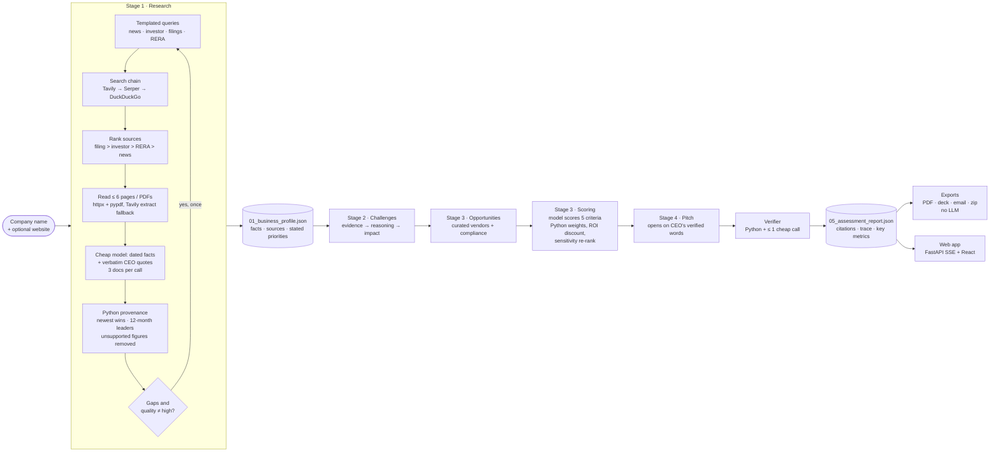
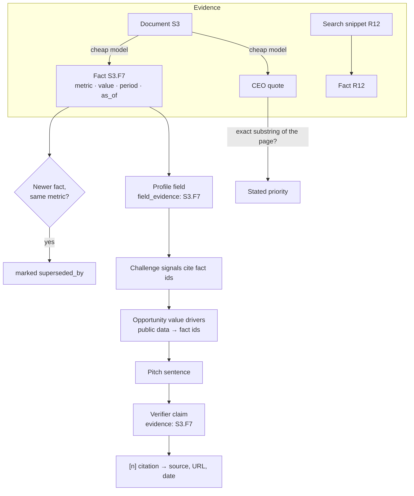
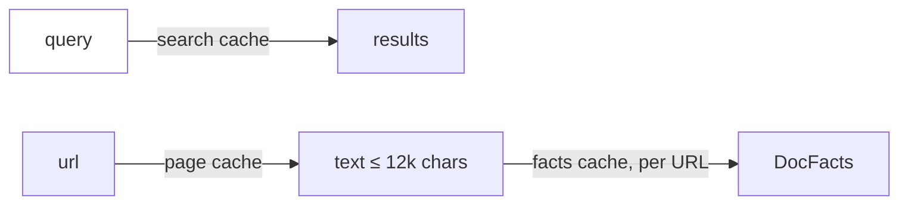

# Approach and architecture

The task: given a company name, produce a 5-section assessment: company overview, key business information, challenges with reasoning, AI opportunities, and a one-page CEO pitch.

The design rule behind everything below: **the language model reads and writes; Python decides and checks.**
- Models summarize sources, diagnose challenges, propose ideas and draft the pitch.
- Python does the things that must be exact and auditable:
  - giving every fact an ID and a date, and deciding which source is newest;
  - checking quotes word for word;
  - scoring, ranking and ROI math;
  - verifying the pitch, building citations, and producing the exports.

## 1. Pipeline



| Stage | Model calls | Python does |
|---|---|---|
| 1. Research | cheap model: fact extraction, ⌈docs/3⌉ calls (+1 for the gap round); main model: profile, 1–2 calls | query templates, source ranking, fetching, fact IDs and dates, newest-wins, the 12-month leader rule, figure checks, verbatim quote check, gap detection |
| 2. Challenges | 1 | checks: 5–8 challenges, all 3 categories, cited signals, reasoning ≥ 20 words |
| 3. Opportunities + scoring | 2 to 3: ideas, rubric scores, decision memo | curated vendor and compliance filtering; weighted score, evidence-adjusted ROI, sensitivity re-rank |
| 4. Pitch + verifier | 1 pitch, ≤ 1 cheap verifier call | opening line, ROI math, name/figure/period checks, replacements and removals |
| Report and exports | 0 | 5-section report, citations, trace graph, key metrics, PDFs, deck, email |

## 2. Data flow and provenance



- **Every fact has an ID and a date.** Documents give `S3.F7`; snippets give `R12`. The date comes from, in order: the date stated in the fact, then the document's publish date, then the retrieval date (only for company or investor pages), and otherwise "unknown".
- **Newest source wins.** Facts are grouped by metric and period type (a quarter never replaces a year). An older fact is marked `superseded_by` the newer one, and prompts see the flag.
- **Leaders need recent, specific evidence.** A name survives only if a cited fact from the last 12 months actually contains it and hasn't been superseded. Otherwise the role becomes "current holder unknown" in `assumptions`.
- **Figures need a source.** A figure in the profile that appears in no fact is removed, with a warning.
- **Main agents never see raw page text.** They only see the fact list, capped at 30,000 characters, newest first.

## 3. Cache, time box and token budget



The disk cache lives at `outputs/<slug>/cache/`, with one JSON file per search query, page and per-URL fact list. A rerun therefore makes **no** search or extraction calls (tested). `--refresh` bypasses it.

| Budget | Value | Why |
|---|---|---|
| Documents read per run | ≤ 6 (`MAX_DOCS`) | Primary sources beat many snippets; bounded cost |
| Text per document | ≤ 12,000 characters, PDFs ≤ 15 pages | Enough for an investor update; extraction stays one batch |
| Extraction | 3 documents per cheap-model call | About 3× fewer calls than per-document |
| Evidence shown to main agents | ≤ 30,000 characters of facts | Facts, not pages: smaller and citable |
| Gap round | at most 1, skipped when data quality is high or < 25 s remain | Fills missing leadership, stale financials or news without looping |
| Research time box | 120 s (`RESEARCH_TIME_BUDGET_S`) | Stops reading new documents and continues with what it has |
| Verifier | 0–1 cheap call, ≤ 20 claims | Python settles most claims |
| Eval judge | 1 cheap call per report, cached | Re-scores only when the report or judge model changes |
| Exports and UI | 0 calls | Built from saved JSON |

Tokens, calls and seconds are logged per stage in `00_run_meta.json` and shown in the web app's Run details popover.

Before this upgrade, a run used about **54k input / 52k output tokens in 7–8 calls** and saw only search snippets; that's the legacy Sobha and Shivalik runs in the eval table. The offline fixture run of the new pipeline makes 11 structured calls. Token figures for live runs of the new pipeline come from `scripts/eval.py` once fresh runs exist; see the README.

## 4. Key decisions and trade-offs

1. **Four model stages, not a swarm of agents.** Each stage has one job and a typed handoff (Pydantic), so a failure is local and `--from-step` can resume. More agents would add calls and cost without adding evidence.
   - *Trade-off:* less "autonomy". The research loop is a fixed template plus one gap round, not an open-ended agent.
2. **Python does the scoring.** The model gives each criterion a 1–10 score with a reason; Python applies the weights, the evidence discount and the sensitivity check. The ranking is reproducible and can't be tipped by the model's arithmetic.
   - *Trade-off:* the rubric is only as good as the weights. They live in `.env` and are shown in the report.
3. **ROI is discounted by its evidence.** `roi × (0.6 + 0.4 × evidence_share)`, where each value driver counts 1 for public data (with a valid fact ID), 0.5 for an industry benchmark and 0 for an assumption. This is what stopped an assumption-heavy idea outranking a core one (§5).
4. **A verifier, not a second writer.** Asking another model to "check the pitch" costs a full call and can hallucinate approval. Python extracts every name, figure and period and matches them to facts. Only claims it can't settle go to one cheap-model call, and the outcome is written to `04_verification.json` with a pass rate.
5. **Curated lists for vendors and compliance.** `data/vendors.yaml` and `data/compliance.yaml` hold official URLs. The model can only pick from them, and anything else is dropped. That's less coverage, but no invented vendors or laws.
6. **Cheap model for reading, strong model for reasoning.** Extraction, quote spotting, leftover claim checks and the eval judge use the cheap model. Challenges, ideas, scoring and the pitch use the main model.
7. **Exports without a model.** The PDF, deck and email are templates over the saved JSON, so they're instant, free, identical every time, and work in demo mode. The on-screen A4 preview is the very HTML the PDF prints.
8. **Free path stays free.** With no keys, search falls back to DuckDuckGo and the Tavily extract fallback is skipped. This is tested.

## 5. Challenges and how they were solved

### The wrong managing director
**What happened.** An early Sobha run addressed the pitch to "Francis Alfred, Managing Director". The current MD is Jagadish Nangineni, re-appointed in July 2026. The same pitch quoted FY2025 figures although FY2026 results were out, and its winning idea rested on assumed ROI.

**Why.** The research stage saw only search snippets with no dates. Older articles outnumbered newer ones, and nothing checked who was current or which figure was newest. Leadership came from whatever the model remembered or saw first.

**How it's caught now**, at three separate layers:
1. **Research.** Role facts are grouped by role; a newer appointment supersedes the older one. A leader is kept only if a dated fact from the last 12 months names them. Test: `test_wrong_md_regression_newest_leader_wins`.
2. **Pitch.** The opening quotes the CEO's own words only if they appear verbatim in a source and the speaker is in current leadership. A former MD's quote can't open the pitch. Test: `test_former_leader_quote_is_not_a_priority`.
3. **Verifier.** Any person the pitch names who isn't a current, evidenced leader is replaced by their title everywhere, including "Dear Mr. Alfred". An FY2025 figure is flagged as stale when an FY2026 fact exists, with a pointer to the newer fact. Tests: `test_wrong_md_is_replaced_with_title_everywhere` and `test_stale_fy2025_figure_is_flagged_when_fy2026_exists`.

The assumed-ROI part is handled by scoring: `test_sobha_assumption_heavy_non_core_idea_no_longer_wins` reproduces an EPC-review idea (ROI 9, all assumptions, low CEO relevance) beating a residential-sales idea under the old weights, and losing under the new ones.

### Other problems along the way
- **Overloaded models looked like a used-up quota.** Gemini returned `503 UNAVAILABLE` and `504 DEADLINE_EXCEEDED` under load, and at first that read as "API limit reached". The real quota error is `429 RESOURCE_EXHAUSTED`. The client now names which one it is, retries transient errors, and on OpenRouter falls back through a list of free models (the run log shows the switch).
- **Tavily rejected a bare `site:` query.** With a website given, research sent only `site:adanirealty.com`. It now adds search terms to the `site:` query, with a test.
- **Dates.** Indian fiscal periods (FY26 ends 31 March 2026; Q1 FY27 ends 30 June 2026), ISO timestamps, and a bare year (never dated in the future) are parsed in `utils/dates.py`, with tests for each case that broke.
- **Front end.** Lazy-loading views once dropped keyboard focus from the report title; views now focus their own heading on mount. In the redesign, the scroll-spy was one section behind because two scroll offsets stacked, and the A4 preview frame was blocked from loading in the embedded browser, so it now uses `srcdoc`. The break-ui worst-case review found a long URL widening the page on phones.

## 6. What's where

```
run_pipeline.py          orchestrator + CLI (--from-step, --refresh, --export)
agents/
  researcher.py          stage 1: queries, ranking, fetch, extraction, gap round
  provenance.py          fact ids/dates, newest-wins, leader rule, figure checks, gaps
  ceo_voice.py           verbatim quotes, stated priorities, pitch opening
  analyst.py             stage 2 · strategist.py stage 3 ideas · evaluator.py stage 3 scoring
  builder.py             stage 4 pitch, ROI, prototype
  verifier.py            pitch claim checks
  trace.py               citations, trace graph, key metrics
  report.py              the 5-section report (JSON + Markdown)
utils/                   llm (Gemini/OpenAI/OpenRouter), search, fetch, cache, dates, sources,
                         catalog (vendors/compliance), evals, export/ (PDF, deck, email)
data/                    vendors.yaml, compliance.yaml (curated, with official URLs)
prompts/                 one Markdown system prompt per model call
api/                     FastAPI: saved runs, SSE analysis stream, exports
frontend/                React + Vite + Tailwind v4 (paper theme, shadcn-style ui/)
scripts/                 demo_api.py (no quota), eval.py, screenshots.py
tests/                   offline tests with fixtures and fakes (no keys)
```
